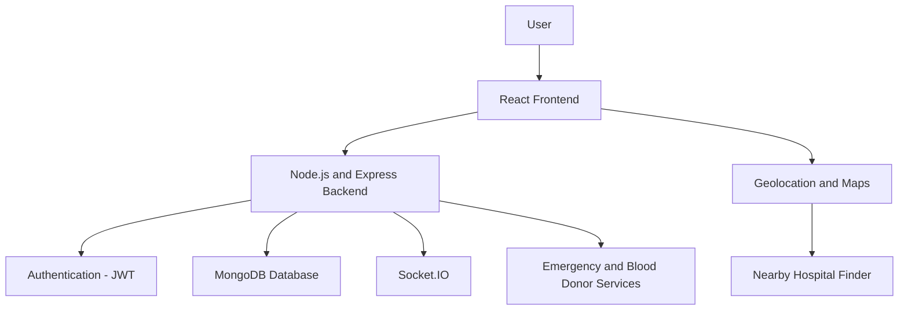

# 🏥 LifeLinkAI
### AI-Powered Emergency Response & Healthcare Assistance Platform

<p align="center">
  <strong>Connecting people to emergency healthcare services when every second matters.</strong>
</p>

<p align="center">
  
  
  
  
  
</p>

---

## 📌 About the Project

**LifeLinkAI** is a healthcare and emergency assistance platform designed to help users access essential medical support during critical situations.

The platform brings together emergency alerts, nearby hospital discovery, medical information, and blood donor search in one place.

Its goal is to simplify emergency communication and help users connect with relevant healthcare resources quickly.

## ✨ Key Features

| Feature | Description |
|---|---|
| 🔐 User Authentication | Secure registration and login with JWT-based authentication |
| 👤 User Profile | Manage personal details and important user information |
| 🆘 SOS Emergency | Send emergency alerts using location services |
| 🏥 Nearby Hospital Finder | Discover nearby hospitals using map integration |
| 🩸 Blood Donation | Search for potential blood donors based on blood group |
| 🪪 Medical ID | Access essential medical information and emergency contacts |
| ⚡ Real-Time Communication | Support real-time updates using Socket.IO |

## 🛠️ Technology Stack

**Frontend**
- React.js
- Vite
- JavaScript
- CSS

**Backend**
- Node.js
- Express.js
- REST APIs
- Socket.IO

**Database & Authentication**
- MongoDB
- JWT
- bcrypt

**Maps & Location**
- JavaScript Geolocation API
- Leaflet
- OpenStreetMap

## 🏗️ System Architecture



## 🔄 Application Workflow

1. User registers or logs in to the platform.
2. User manages their profile and medical information.
3. In an emergency, the user can activate the SOS feature.
4. The application uses location services to support emergency assistance.
5. Users can explore nearby hospitals and search for blood donors.
6. Real-time communication supports emergency updates.

## 📂 Project Structure

```text
LifeLinkAI/
│
├── client/              # React frontend
│   ├── public/
│   └── src/
│       ├── components/
│       ├── pages/
│       ├── services/
│       └── ...
│
├── server/              # Node.js backend
│   ├── controllers/
│   ├── models/
│   ├── routes/
│   ├── middleware/
│   └── ...
│
├── docs/                # Project documentation
├── .github/             # GitHub workflows and configuration
├── .gitignore
└── README.md
```

## 🚀 Getting Started

### 1. Clone the repository

```bash
git clone https://github.com/sanjith1214/LifeLinkAI.git
cd LifeLinkAI
```

### 2. Install dependencies

Open separate terminals for the frontend and backend.

**Frontend**
```bash
cd client
npm install
```

**Backend**
```bash
cd server
npm install
```

### 3. Configure environment variables

Create the required `.env` files for the frontend and backend based on the environment variables used in the project configuration.

Do not upload API keys, database credentials, JWT secrets, or other sensitive information to GitHub.

### 4. Run the application

Start the backend and frontend using the scripts defined in their respective `package.json` files.

## 🔮 Future Enhancements

- Improved emergency alert and response coordination.
- Expanded hospital and healthcare service coverage.
- Enhanced blood donor discovery.
- Additional medical profile and emergency support features.
- Improved scalability and performance.

## 🎯 Project Objective

To develop an integrated healthcare assistance platform that makes emergency support, medical information, hospital discovery, and blood donor search more accessible through a unified web application.

## 👨‍💻 Contributors

Developed as a collaborative team project.

## 📄 License

This project is intended for educational and development purposes. Add a license file if you plan to distribute it under a specific open-source license.

---

<p align="center">
  <strong>❤️ LifeLinkAI — Every Second Matters.</strong>
</p>